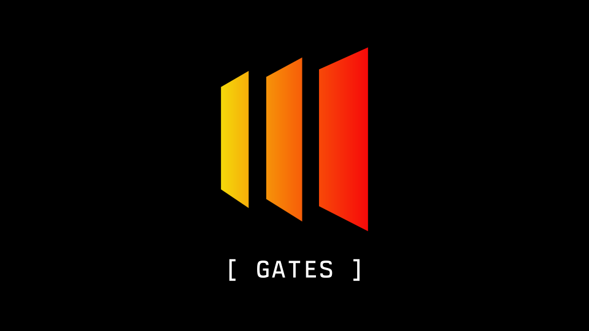

<p align="center">
  
</p>

<p align="center">
  <a href="https://www.npmjs.com/package/irondome-gates">
    
  </a>
</p>

<p align="center">
  <a href="docs/public/gates/index.md"><strong>Documentation</strong></a> ·
  <a href="examples/docs/README.md"><strong>Examples</strong></a> ·
  <a href="docs/public/gates/migration.md"><strong>Migration guide</strong></a>
</p>

# GATES

GATES is a server-side library that blocks disposable-email signups and helps prevent multiple accounts created with email aliases, such as `+tags` and dotted Gmail addresses.

It combines [IronDome](https://irondome.dev) disposable-email checks, Mail Canon normalization and PostgreSQL-backed ownership checks. Connectors are available for **Better Auth, Auth0 and Supabase Auth**.

## Email providers

Alias rules are provider-specific. GATES does not strip dots or `+tags` from every email address.

| Provider | Default alias matching |
| --- | --- |
| Gmail / Googlemail | Removes dots and `+tags`; maps `googlemail.com` to `gmail.com`. |
| Outlook / Hotmail / Live / MSN | Removes `+tags` on `outlook.com`, `hotmail.com`, `live.com` and `msn.com`. Keeps dots and each domain distinct. |
| Proton | Removes `+tags`, dots, underscores and hyphens. Keeps `proton.me`, `protonmail.com`, `protonmail.ch` and `pm.me` distinct. |
| Fastmail | Removes `+tags` on 130 supported first-party domains and resolves one-level subdomain aliases. Keeps dots and each root domain distinct. |
| Custom domains | Preserves the local part by default. Configure exact-domain rules for lowercasing, `+tag` removal or dot removal. |

Custom rules should only combine addresses you know reach the same mailbox. Google Workspace and Microsoft 365 custom domains do not inherit consumer-provider rules. GATES keeps the original address for delivery and verification; duplicate ownership is enforced within each project after verification.

## Installation

```sh
npm install irondome-gates pg
```

See the [installation guide](docs/public/gates/installation.md) for requirements and setup.

**Requirements:** Node.js 22+, ESM and PostgreSQL. The Better Auth connector requires Better Auth 1.7.7.

## Connectors

- [Better Auth](docs/public/gates/quickstart/better-auth.md)
- [Auth0](docs/public/gates/quickstart/auth0.md)
- [Supabase](docs/public/gates/quickstart/supabase.md)

Each guide covers setup, verification, email changes, deletion and protected access. See the [documentation](docs/public/gates/index.md), [integration examples](examples/docs/README.md) and [deployment checklist](docs/public/gates/deployment.md).

## Migration

For existing users, [check collisions and establish ownership](docs/public/gates/migration.md) before enabling enforcement. Initial adoption and online canonical-policy changes are separate workflows.

## Behavior

- Screening uses the exact submitted address, not a rewritten delivery destination.
- Canonical claims are created only after the provider proves ownership.
- Concurrent users cannot claim the same canonical identity within a tenant.
- Verified email changes use captured ownership revisions; deletion terminally revokes the stable user ID before provider cleanup.
- Protected server operations use current provider state and live GATES ownership, rather than trusting an old token alone.

A canonical match does not authenticate a user, merge accounts or establish a person's identity. GATES does not prevent every type of trial abuse, and provider-specific integration limits still apply.

## Example

```ts
import { prepareEmail } from 'irondome-gates';

const email = prepareEmail('alex+trial@gmail.com');
console.log(email.canonical);     // alex@gmail.com
console.log(email.deliveryEmail); // alex+trial@gmail.com
```

This only prepares an address. It performs no screening, ownership claim or authentication. Use the provider guides for complete integration boundaries.

## Development

```sh
npm ci --ignore-scripts --no-audit --no-fund
npm test
npm run build:package
node node_modules/typescript/bin/tsc -p examples/docs/tsconfig.json
node tools/check-public-docs.mjs
npm run package:smoke
```

`npm test` skips PostgreSQL/GoTrue integration entrypoints when their disposable test environment is absent. Use the qualified suite described in [CONTRIBUTING.md](CONTRIBUTING.md) before treating a release as integration-tested. Never point destructive qualification scripts at production.

Public documentation is maintained in this repository through an [explicit page manifest](docs/public/gates/manifest.json). Its website routes are planned under `irondome.dev/docs/gates`; website publication is a separate release step.

## Publishing

Use a disposable PostgreSQL database and the official GoTrue binary configured as described in [CONTRIBUTING.md](CONTRIBUTING.md). The release check fails if integration prerequisites are missing or any test is skipped.

```sh
npm ci --ignore-scripts
npm run release:check
npm pack
```

Inspect the resulting tarball before publishing. `release:check` validates the source allowlist, documentation, zero-skip test suite and installed-package consumers; it does not publish or authenticate to npm. Confirm npm scope access, the intended version and distribution tag before running a publish command. A beta distribution tag does not change the package's version string.

## License

[MIT](LICENSE). Bundled dependencies retain their own license notices. This license covers the library, not IronDome's hosted service or private detection data.
